# Munzir (منذر) — Enterprise Cloud Architecture at Scale

> **Document Type:** Production Architecture Specification & Scalability Blueprint  
> **Target Scale:** Multi-Emirate / National Public Health Surveillance (10,000,000+ residents, 2,500+ industrial worksites, 50,000+ telemetry events/sec)  
> **Security Clearance:** Public Health Authority & Enterprise Industrial EHS  
> **Reference Plan:** Munzir Implementation Plan — Phase 9 (Deployment Hardening & Scalability)

---

## 1. Executive Summary & Design Principles

Munzir (منذر) is designed as a **cloud-native, horizontally scalable, multi-tenant population and workforce health early-warning platform**. While the student/hackathon prototype runs within a single scale-to-zero container for cost efficiency ($0.00 idle on Azure for Students), the enterprise deployment scales seamlessly to process real-time environmental, clinical, and occupational telemetry across all seven Emirates.

### Core Architectural Tenets
1. **Embarrassingly Parallel Spatial Partitioning:** Detection pipelines are partitioned by administrative district and H3 hexagonal indices (Resolution 7 ~ 5.16 km²), enabling independent horizontal scaling without cross-region locking.
2. **Lakehouse Architecture (Medallion Pattern):**
   - **Bronze:** Append-only immutable telemetry streams (raw JSON/Parquet).
   - **Silver:** Privacy-sanitized, coordinate-snapped, rate-calculated, suppressed ($k \le 10$) analytical tables.
   - **Gold:** Calibrated outbreak predictions, conformal risk bands, SHAP feature attributions, and published action playbooks.
3. **Stateless Compute with KEDA Autoscaling:** API and detection workers run as stateless microservices on **Azure Container Apps (ACA)** autoscaling via Kubernetes Event-driven Autoscaling (KEDA) based on queue depth and CPU utilization.
4. **Zero-Trust Security & Confidential Computing:** All credentials reside in Azure Key Vault; inter-service communication utilizes Microsoft Entra ID Managed Identities with mTLS; data at rest is encrypted with customer-managed keys (CMK).

---

## 2. Architecture Diagram (Enterprise Topology)

```mermaid
flowchart TD
    subgraph Ingestion["1. Edge & Multi-Source Ingestion"]
        A1["Open-Meteo & ERA5 API<br/>(Hourly Weather/WBGT)"]
        A2["OpenAQ v3 & CAMS<br/>(Real-Time PM2.5 / AQI)"]
        A3["DHA NABIDH / Malaffi<br/>(HL7 FHIR Syndromic Stream)"]
        A4["Enterprise EHS Batches<br/>(SFTP / CSV Zero-PII Drop)"]
        A5["Community & Telehealth Feeds<br/>(Encrypted Webhook)"]
    end

    subgraph Streaming["2. Scalable Streaming & Event Hub"]
        B1["Azure Event Hubs / Kafka<br/>(Partitioned by Geo-Region)"]
        B2["Azure Stream Analytics / Functions<br/>(Schema Validation & Edge Anonymization)"]
    end

    subgraph Storage["3. Lakehouse Data Tier (Azure ADLS Gen2 & PostGIS)"]
        C1[("Bronze Storage<br/>Raw Delta Lake / Parquet")]
        C2[("Silver Storage<br/>Azure DB for PostgreSQL Flexible<br/>+ Citus Distributed Tables + PostGIS")]
        C3[("OpenDP Differential Privacy<br/>& Small-Cell Suppression Engine")]
    end

    subgraph Analytics["4. Distributed Detection Engine (Azure Container Apps)"]
        D1["L1 Aberration Workers<br/>(CDC EARS C1-C3 & Farrington)"]
        D2["L2 Exposure Baselines<br/>(Distributed DLNM Models)"]
        D3["L3 Space-Time Cluster Scan<br/>(H3 Hexagon Spatial Clustering)"]
        D4["L4 LightGBM Fusion Workers<br/>(Calibrated Probabilities + SHAP)"]
        D5["L5 Anti-Fatigue Policy Engine<br/>(Hysteresis & DQ Guardrails)"]
    end

    subgraph Decision["5. Action Engine & Governance"]
        E1["Action Playbook Dispatcher<br/>(MOHRE / DHA Multi-Agency RACI)"]
        E2["Fenced LLM Narrative Synthesizer<br/>(Grounding & Anti-Hallucination Fences)"]
        E3["Automated Drift Monitor<br/>(Population Stability Index PSI & Brier)"]
    end

    subgraph Presentation["6. Presentation & Interoperability"]
        F1["Munzir Web Dashboard<br/>(MapLibre GL + Role-Based UI)"]
        F2["HL7 FHIR R4 Surveillance Server<br/>(MeasureReport & RiskAssessment)"]
        F3["Enterprise EHS Sync<br/>(Enablon / Cority Connectors)"]
        F4["Public Health DP Data Portal<br/>(Differentially Private Releases)"]
    end

    Ingestion --> Streaming
    Streaming --> Storage
    Storage --> Analytics
    Analytics --> Decision
    Decision --> Presentation
```

---

## 3. Storage & Compute Sizing at National Scale

### 3.1 Telemetry Sizing Matrix (UAE National Deployment)

| Data Feed | Frequency | Daily Records | Monthly Uncompressed | Monthly Parquet (Bronze) | Retention Policy |
| :--- | :--- | :--- | :--- | :--- | :--- |
| **Environmental (Open-Meteo)** | Hourly (70 H3 Hexes) | 1,680 | 12 MB | 2.1 MB | 10 Years (Climate Baseline) |
| **Air Quality (OpenAQ / CAMS)** | Hourly (70 H3 Hexes) | 1,680 | 15 MB | 2.4 MB | 10 Years (Longitudinal Trend) |
| **Clinical Syndromic (DHA/Malaffi)** | Daily (9 Districts) | 1,000 | 8 MB | 1.2 MB | 5 Years (Epi Surveillance) |
| **Workplace Telemetry (MOHRE)** | Daily (2,500 Sites) | 10,000 | 45 MB | 6.8 MB | 7 Years (Statutory Safety) |
| **Pharmacy / Labs** | Daily (9 Districts) | 500 | 4 MB | 0.8 MB | 5 Years |
| **Total Production Ingestion** | — | **~15,000/day** | **~84 MB/day** | **~13.3 MB/day (~400 MB/mo)** | **Tiered Lifecycle** |

*Note: Due to privacy-preserving aggregation at the edge, data volumes remain exceptionally compact (~5 GB/year), ensuring minimal storage costs and sub-second query performance even over multi-year lookbacks.*

---

## 4. High-Availability, Disaster Recovery & SLAs

### 4.1 Service Level Agreements (SLAs)
- **API Availability:** 99.95% uptime (< 4.38 hours downtime/year).
- **Early-Warning Ingestion SLA:** < 15 minutes from telemetry arrival to published alert.
- **Evidence Card Rendering SLA:** < 1.5 seconds for complete multi-signal drilldown.
- **Fail-Safe Fallback SLA:** < 500ms automated failover to deterministic CDC EARS C2 baseline if ML fusion fails.

### 4.2 Disaster Recovery & Multi-Region Topology
- **Primary Region:** Azure UAE North (Dubai) — hosting live API, Container Apps, and primary PostgreSQL Flexible Server.
- **Secondary (DR) Region:** Azure UAE Central (Abu Dhabi) — read-replica database with automated geo-failover and standby container apps.
- **Recovery Point Objective (RPO):** < 5 minutes (continuous WAL streaming).
- **Recovery Time Objective (RTO):** < 15 minutes (automated DNS traffic reroute via Azure Front Door).

---

## 5. Continuous Model Monitoring & Drift Defense

To prevent algorithmic degradation in changing climate or epidemiological conditions, Munzir implements an automated surveillance drift monitor:

1. **Covariate Shift Detection (Population Stability Index - PSI):**
   $$\text{PSI} = \sum_{i=1}^k \left( \text{Actual}_i - \text{Expected}_i \right) \times \ln\left( \frac{\text{Actual}_i}{\text{Expected}_i} \right)$$
   - $\text{PSI} < 0.10$: Model stable; nominal operation.
   - $0.10 \le \text{PSI} < 0.25$: Moderate drift; triggers automatic alert for epidemiologist review.
   - $\text{PSI} \ge 0.25$: Significant covariate shift; automatically widens conformal intervals by $1.5\times$ and recommends model retraining.

2. **Calibration Drift (Rolling Brier Score):**
   Monitors the calibration of predicted probabilities against verified 14-day retrospective outcomes. If Brier score increases by $>30\%$, the system switches the display confidence band to conservative mode.

3. **Data Freshness Alarms:**
   Telemetry feeds with latency $> 48$ hours trigger automated data quality degradation flags, visually capping jurisdictional alert severity at **Warning** to prevent false alarms.

